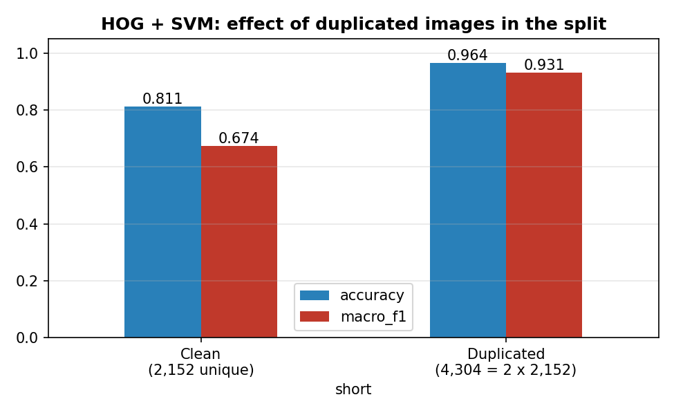
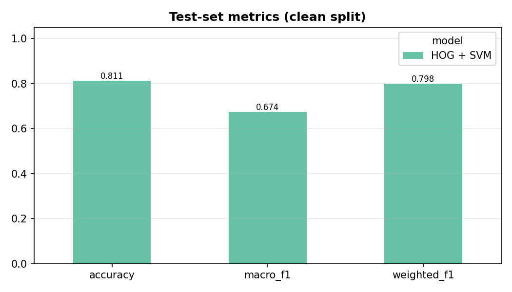
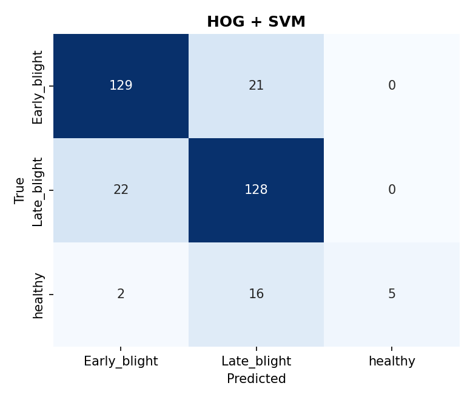
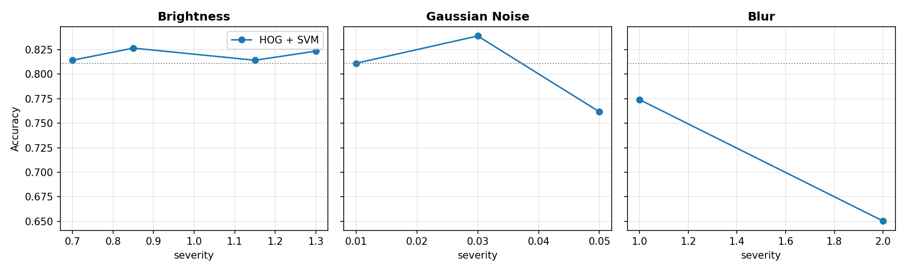

# Plant Disease Classification & Robustness Benchmark

A reproducible computer vision project for potato leaf disease classification,
model comparison and robustness evaluation (HOG + SVM vs. a custom CNN).

## Research questions

1. How does a custom CNN compare with an HOG + SVM baseline?
2. How does performance vary across disease classes (especially `healthy`)?
3. How sensitive are the models to lighting, noise and blur?
4. How much can data leakage (duplicated images) inflate reported metrics?

## Key finding: a data-integrity audit

The original coursework reported 4,304 images and 99.38% CNN accuracy. The
public dataset used here contains **2,152 unique images** (1,000 early blight,
1,000 late blight, 152 healthy; 0 exact duplicates, 0 unreadable). 4,304 is exactly
2 x 2,152, so the original run most likely used every image twice, and a random
split put copies of the same image in train and test.

`scripts/leakage_audit.py` reproduces this effect with HOG + SVM, same code and
parameters, only the data differs:

| Dataset | Test images | Images shared by train/test | Accuracy | Macro F1 |
|---|---|---|---|---|
| Clean (2,152 unique) | 323 | 0 | 0.811 | 0.674 |
| Duplicated (4,304) | 646 | 987 | 0.964 | 0.931 |

The duplicated setting gives 96.4% accuracy, close to the 96.28% in the original
report, which supports the explanation. It is evidence, not proof: the original
dataset archive is not available to this repository.



## Results (clean, de-duplicated split, seed 42)

Split: 1,506 train / 323 validation / 323 test, stratified, shared by all models.

| Model | Accuracy | Macro F1 | Weighted F1 | Healthy recall | Train (s) |
|---|---|---|---|---|---|
| HOG + SVM | 0.811 | 0.674 | 0.798 | 0.217 (5/23) | 14.5 |
| Custom CNN | _run `--models cnn` (see below)_ | | | | |

The SVM almost never recovers healthy leaves (precision 1.00, recall 0.22):
the class is only 7% of the data. Accuracy hides this; macro F1 and
per-class recall expose it.




### Robustness (HOG + SVM, accuracy on the same 323 test images)

| Corruption | Levels -> accuracy |
|---|---|
| none | 0.811 |
| brightness x0.7 / 0.85 / 1.15 / 1.3 | 0.814 / 0.827 / 0.814 / 0.824 |
| gaussian noise sigma 0.01 / 0.03 / 0.05 | 0.811 / 0.839 / 0.762 |
| blur sigma 1 / 2 | 0.774 / 0.650 |

HOG is robust to global brightness changes (gradient-based, normalised blocks)
but degrades with blur, which removes the edges it relies on. The small rise at
noise 0.03 is within the variation expected on 323 images (23 healthy) and
should not be interpreted as a benefit.



## Legacy results

`legacy/` holds the original coursework numbers (CNN 99.38%, SVM 96.28%) as CSV and the original figures in `legacy/figures/` (class distribution, training curves, confusion matrices, comparison bar).
They are kept for traceability only, see `legacy/NOTES.md` for why they must not
be quoted as clean results.

## Status

- Done: clean-split HOG + SVM, robustness (SVM), leakage audit, tests, CI config.
- Pending: Custom CNN on the clean split (`--models svm cnn`), Power BI dashboard, CI badge (after the first green run).
- Not run in the authoring environment: `pytest` and `ruff` (tests were run with a minimal runner; 23/23 passed).

## Repository structure

```
configs/      baseline.yaml, robustness.yaml
src/plant_disease/  data, preprocessing, models, train, evaluate, robustness
scripts/      inspect_dataset, run_experiments, leakage_audit, make_figures, legacy_results
notebooks/    01_exploratory_analysis.ipynb (EDA + integrity audit)
tests/        23 unit tests (no TensorFlow needed)
outputs/      CSV results (model_metrics, per_class_metrics, predictions, ...)
reports/figures/  generated figures
powerbi/      dashboard instructions
```

## Installation

```bash
conda create -n plant-disease-ml python=3.10 -y
conda activate plant-disease-ml
pip install -r requirements.txt
pip install -e ".[dev]"
```

## Data

The public PlantVillage potato subset (2,152 images, ~42 MB) is included in
`data/task1/` (see `data/README.md` for source and licence note).

## Run

```bash
python scripts/inspect_dataset.py              # counts, unreadable, duplicates
python scripts/leakage_audit.py                # leakage impact (HOG + SVM)
python scripts/run_experiments.py --models svm cnn   # baseline + robustness
python scripts/make_figures.py                 # figures in reports/figures
pytest -q
```

Use `--data-dir <path>` to point to the dataset anywhere on disk. CNN training
needs TensorFlow 2.15 (`pip install -e ".[cnn]"`).

## Metrics

Accuracy, macro F1, weighted F1, per-class precision/recall/F1, confusion
matrices, train and inference time. Macro F1 and healthy recall are the primary
metrics because of the 1000:1000:152 imbalance.

## Testing and CI

Unit tests cover dataset discovery, unreadable files, exact duplicates,
split disjointness, preprocessing shapes, corruptions and metrics. GitHub Actions
runs `ruff` and `pytest` without training models.

## Limitations

- Only exact (byte-identical) duplicates are checked; near-duplicates
  (e.g. several photos of one leaf) may still inflate results.
- Single seed and single split; no confidence intervals. Healthy test set has only 23 images.
- Laboratory-condition images; field performance is untested.
- The CNN is trained from scratch (no transfer learning).

## Future work

Repeated stratified runs with confidence intervals, near-duplicate detection,
transfer learning (e.g. ResNet / EfficientNet), class-weighted loss, field images.

## References and attribution

- Hughes & Salathe (2015), *An open access repository of images for plant disease identification*, arXiv:1511.08060 (PlantVillage).
- Dalal & Triggs (2005), Histograms of oriented gradients for human detection, CVPR.
- Cortes & Vapnik (1995), Support-vector networks, Machine Learning.
